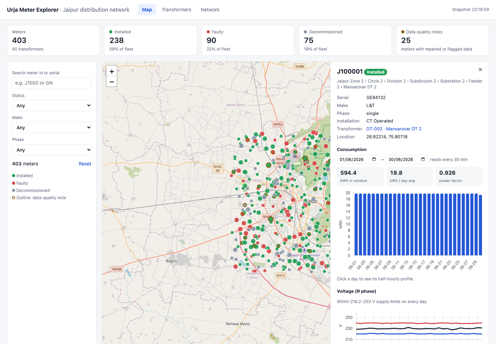

# Urja Meter API

A clean, documented, read-only HTTP API over the **Urja Meter Ops** portal, a
legacy web app that has no API. Other engineers and programs can use it to
query smart meters, their place in the electricity network, their location and
their energy readings, without touching the portal.

It also ships a small **web client**, the Urja Meter Explorer, built only on
top of this API. It shows a map of the fleet, transformer health, a network
explorer and per-meter consumption charts.

* **How the portal works under the hood:** [PROTOCOL.md](PROTOCOL.md)
* **API description (OpenAPI 3.1):** [openapi.json](openapi.json). When the
  service is running, browse it at <http://localhost:8080/docs> (Swagger UI) or
  <http://localhost:8080/redoc>.
* **Reflection:** [at the bottom of this file](#reflection)

---

## Quick start

You need Python 3.9 or newer, or Docker. The portal URL and credentials from
the assignment are built-in defaults, so there is nothing to configure.

```bash
python3 -m venv .venv
.venv/bin/pip install -r requirements-dev.txt
.venv/bin/uvicorn app.main:app --port 8080
```

Or with Docker:

```bash
docker build -t urja-meter-api .
docker run --rm -p 8080:8080 urja-meter-api
```

Then open <http://localhost:8080/> for the web client, or call the API:

```bash
curl localhost:8080/health
curl "localhost:8080/v1/meters?install_status=Faulty&feeder=F-007"
```

Run the tests. They don't touch the real portal.

```bash
.venv/bin/pytest
```

Regenerate `openapi.json` after changing routes or models:

```bash
PYTHONPATH=. .venv/bin/python scripts/export_openapi.py
```

### Configuration

All settings are optional environment variables (see [.env.example](.env.example)):

| Variable | Default | Meaning |
|---|---|---|
| `PORTAL_URL` | `https://urja-ops.flockenergy.tech` | Portal base URL |
| `PORTAL_EMAIL` / `PORTAL_PASSWORD` | assignment credentials | Portal login |
| `PORTAL_REQUESTS_PER_MINUTE` | `100` | Client-side throttle. The portal 429s at about 120. |
| `INDEX_TTL_SECONDS` | `600` | How long the fleet snapshot is considered fresh |
| `READINGS_TTL_SECONDS` | `300` | How long a readings response is cached |
| `REQUEST_TIMEOUT_SECONDS` | `20` | Per-request timeout to the portal |
| `WARM_ON_STARTUP` | `1` | Load the snapshot at startup. Set to `0` to load it on the first request instead. |

---

## The API

All responses are JSON. Errors always have the same shape:

```json
{ "error": { "code": "not_found", "message": "Meter J999 not found" } }
```

| Status | `code` | When |
|---|---|---|
| 404 | `not_found` | Unknown meter, transformer or route |
| 422 | `invalid_request` | Bad parameters (the message says which) |
| 502 | `portal_error` / `portal_auth_failed` | The portal answered with something unexpected or rejected our login |
| 503 | `portal_unavailable` | The portal kept failing (rate limit, 5xx, network) after retries |

| Endpoint | What it gives you |
|---|---|
| `GET /v1/meters` | Search, filter and paginate meters. Filters: `q` (id/serial substring), `install_status`, `make`, `phase_type`, `install_type`, any hierarchy level by code (`zone`, `circle`, `division`, `subdivision`, `substation`, `feeder`, `dt`). Proximity search with `near_lat`, `near_lng`, `radius_km`. Paging with `page`, `page_size` (max 500). |
| `GET /v1/meters/{id}` | One meter: nameplate, full hierarchy, location, data-quality notes |
| `GET /v1/meters/{id}/readings` | Readings for a date window (`from`, `to`, inclusive). `resolution=raw` gives typed readings plus per-interval consumption. `resolution=daily` gives kWh, kVAh, power factor and voltage per day. |
| `GET /v1/transformers` | All 40 distribution transformers with meter counts by status. Optional `feeder` filter. |
| `GET /v1/transformers/{code}` | One transformer |
| `GET /v1/hierarchy` | The network as a tree (zone → … → DT) with meter counts at every node |
| `GET /v1/summary` | Fleet-wide counts by status, make, phase and install type |
| `GET /health` | `ok` / `degraded` (serving a stale snapshot) / `unavailable` |

### Sample requests

```bash
# Faulty three-phase meters, 1 per page
curl "localhost:8080/v1/meters?install_status=Faulty&phase_type=three&page_size=1"
```

```json
{
  "data": [
    {
      "meter_id": "J100005",
      "serial_no": "HP63682",
      "make": "Allied",
      "phase_type": "three",
      "install_status": "Faulty",
      "install_type": "Whole Current",
      "nameplate_format": "legacy",
      "hierarchy": {
        "zone": {"code": "Z-03", "name": "Jaipur Zone 3"},
        "circle": {"code": "C-06", "name": "Circle 6"},
        "division": {"code": "D-06", "name": "Division 6"},
        "subdivision": {"code": "SD-06", "name": "Subdivision 6"},
        "substation": {"code": "SS-06", "name": "Substation 6"},
        "feeder": {"code": "F-006", "name": "Feeder 6"},
        "dt": {"code": "DT-006", "name": "Jhotwara DT 6"}
      },
      "location": {"latitude": 26.84670538836401, "longitude": 75.86828425070057},
      "data_quality": [],
      "distance_km": null
    }
  ],
  "page": {"page": 1, "page_size": 1, "total": 35, "total_pages": 35},
  "freshness": {"snapshot_loaded_at": "2026-10-27T17:20:02.431780Z", "stale": false}
}
```

```bash
# Meters within 1.5 km of a point, nearest first
curl "localhost:8080/v1/meters?near_lat=26.9124&near_lng=75.7873&radius_km=1.5"

# Daily consumption for a meter over the last week of June
curl "localhost:8080/v1/meters/J100001/readings?from=2026-06-24&to=2026-06-30&resolution=daily"
```

```json
{
  "meter_id": "J100001",
  "resolution": "daily",
  "interval_minutes": 30,
  "window_start": "2026-06-24T00:00:00+05:30",
  "window_end": "2026-06-30T23:30:00+05:30",
  "total_kwh": 138.38,
  "daily": [
    {"date": "2026-06-24", "kwh": 19.82, "kvah": 21.42, "power_factor": 0.925, "intervals": 48,
     "voltage_r_min": 220.0, "voltage_r_max": 240.0, "voltage_r_avg": 228.7},
    "... one entry per day to 2026-06-30 ..."
  ],
  "data_quality": []
}
```

> The portal only holds readings for **June 2026**. Outside that range you get
> an empty result, not an error.

---

## The web client

Open <http://localhost:8080/> while the service is running. It is built purely
on the `/v1` API, so it doubles as a worked example of using the API.



* **Summary tiles.** Fleet size and status split. Click a tile to filter the
  map.
* **Map.** Every meter is coloured by status. Three-phase meters are drawn
  larger, and meters with data-quality notes are outlined. You can filter by
  search, status, make and phase.
* **Meter panel.** Click a meter to see:
  * its nameplate and its path through the network;
  * any data-quality notes;
  * daily consumption with power factor (click a day for its half-hourly
    profile);
  * daily voltage against the 216–253 V supply limits for 230 V consumers in
    India (+10% / −6%).

  The panel also flags meters marked Faulty or Decommissioned that are still
  reporting consumption.
* **Transformers.** Ranked by share of faulty meters, with a status bar per
  transformer. Click a row to see its meters on the map.
* **Network.** A collapsible zone → … → transformer tree with meter counts.
  Click any node to see its meters on the map. The filter uses the node's full
  path, because codes repeat under different parents.
* **Deep links.** `/ui/#meter=J100001` opens a meter directly, and
  `/ui/#view=dt-view` opens the transformers tab.

Map tiles come from OpenStreetMap, and Leaflet and Chart.js load from a CDN,
so the browser needs internet access.

## How it's built

```
app/
  portal.py     Portal client: login and re-login, rate limiting, retries,
                HMAC-signed export, SvelteKit __data.json decoding.
                The only module that knows the portal's wire format.
  normalize.py  Pure functions: both nameplate formats, hierarchy parsing and
                repair, reading typing, de-duplication, consumption, daily rollups.
  index.py      In-memory fleet snapshot: filtering, proximity search,
                hierarchy tree, summary.
  schemas.py    Pydantic response models (these also generate openapi.json).
  main.py       FastAPI routes, validation, error mapping, readings cache.
  config.py     Environment-based settings.
  static/       The web client: one HTML file, no build step. It only
                calls the public /v1 API.
tests/          Unit tests for normalisation, client tests against a mock
                portal, and API tests against a fake portal.
```

**Request flow:**

* **Meter, transformer, hierarchy and summary queries** are answered from an
  **in-memory snapshot**. It is built from the portal's signed bulk export (one
  request for all 403 meters) plus the transformer list (two requests). It is
  loaded at startup.
* **Refreshing the snapshot.** Once it is older than 10 minutes, the next
  request is still answered from it straight away, while one background task
  refreshes it. Requests never wait for a refresh.
* **Readings** are fetched **live** from the portal per request, normalised
  and cached for 5 minutes. Identical requests that arrive together share one
  portal call.
* **A meter not in the snapshot** (e.g. added since the last refresh) is
  fetched live from the meter page and geo endpoint. The response says
  `"source": "live"`.

---

## Assumptions

* **Timezone.** Portal timestamps have no zone. I treat them as Asia/Kolkata
  (+05:30), since this is a Jaipur utility, and return ISO 8601 with the
  offset.
* **kWh/kVAh are cumulative registers.** Consumption is the difference between
  consecutive readings. A decrease is treated as a reset or bad read: it is
  excluded from consumption and flagged.
* **Daily consumption** for an interval is counted on the day the interval
  *starts*. The last day of a window can therefore be partial; its
  `intervals` field shows how many intervals it covers (48 = a full
  half-hourly day).
* **The transformer register is authoritative for transformer names.** When a
  meter reports a different name (the "Old Malviya Nagar Xfmr" case), the
  meter keeps what the portal said and gets a flag.
* **Repairs are inferred from the fleet.** A blank code is filled from the
  name, using the code most other meters pair with that name, and vice versa. Every
  repair is visible in `data_quality`, so consumers can ignore it if they
  disagree.
* **This API is read-only**, like what the portal exposes to this user.
* **A few minutes' staleness is acceptable** for meter metadata (status,
  hierarchy). That data changes on the timescale of field visits, not seconds.
  Readings are not served from the snapshot.

## Design decisions and trade-offs

* **Snapshot-and-index instead of proxying each request.** The portal can
  only search by id/serial and allows about 120 requests a minute. Answering
  "faulty meters on feeder F-007" or "meters near here" live would take
  hundreds of calls. The bulk export makes a full snapshot cost 3 requests.
  * Cost: data can be up to `INDEX_TTL_SECONDS` old. Every response carries
    `freshness` so consumers can see this.
  * If a refresh fails, we keep serving the previous snapshot with
    `stale: true` rather than fail. We then wait 30 seconds before trying
    again, so an outage doesn't turn every request into another hit on the
    portal. If there is no snapshot yet, requests during that cooldown get an
    immediate 503 rather than each waiting through retries.
* **Protect the portal's session and budget.** When the 1-hour session
  expires, concurrent requests trigger a single re-login, not one each. Meter
  ids are validated before being put into portal URLs, so a value like `..`
  can't reach other portal paths.
* **Use the export, not the per-meter pages, for metadata.** It is one call
  instead of about 800, it is already structured, and it is the path the
  portal itself uses for "export all". The per-meter path is still
  implemented (and tested) for meters missing from the snapshot. That is
  where the two nameplate formats get handled.
* **Readings are live, not crawled.** Pre-fetching every meter's readings
  would take about 4 minutes of rate-limit budget and mostly go unused. A
  short cache covers repeated requests.
* **Report data problems instead of hiding them.** Every repair or anomaly is
  listed in `data_quality`. Consumers get clean data *and* the reasons, which
  matters when a utility uses this data to make decisions.
* **Hierarchy is a tree of paths, not of codes.** Below circle level, codes
  repeat under different parents (D-01 under three circles). Keying nodes by
  code would build a graph that misattributes meters.
* **Throttle proactively, then back off.** The portal sends no `Retry-After`
  header, so the best strategy is to never trigger the limit. Backoff is the
  safety net.
* **Plain Python + FastAPI, no database.** 403 meters fit trivially in memory,
  and FastAPI produces the OpenAPI document from the same models that validate
  responses, so the spec can't drift from the code.
* **Versioned paths (`/v1`)** so the shape can evolve without breaking
  consumers.

## Intentionally left out

* **Authentication on this API.** It runs as one shared portal account. In
  production it would sit behind the company's gateway/SSO, which shouldn't be
  reinvented here.
* **The default credentials in `config.py`** are there so a reviewer can run
  it with zero setup. In production they would come only from a secrets
  manager.
* **Persistent storage.** Restarting the service rebuilds the snapshot in
  about 2 seconds.
* **Multi-instance coordination.** The rate limiter is per process. Two
  replicas would share the portal's budget without knowing it.
* **A front-end build pipeline or framework.** The web client is a single
  HTML file using Leaflet and Chart.js from a CDN, so there is nothing to
  install or build. A larger client would justify React/Vite and its own
  tests; this one doesn't yet.
* **Fleet-wide consumption analytics** (e.g. "top 10 consumers"). This needs
  all readings, which means a background crawl under the rate limit.

## Scale: where the local index would start to struggle

Today every query is a linear scan over 403 meters, which takes microseconds.

* **Up to about 100k meters**, linear scans stay well under 100 ms. Memory
  (about 1 KB per meter) is fine.
* **Beyond that**, I would move the snapshot into **SQLite or Postgres**,
  with indexes on status, make and each hierarchy code, and a spatial index
  (PostGIS, or a geohash/R-tree) for `near` queries.
* **Refreshes would also change.** A single export call returning millions of
  rows wouldn't be realistic. I'd page through it and refresh incrementally if
  the portal ever exposes "changed since".
* **For readings at scale**, a scheduled crawler would write into a
  time-series store (e.g. TimescaleDB). The API would read from that instead
  of proxying, and the portal's rate limit would only constrain how fresh that
  store is.

## What I'd improve with more time

* **A background readings crawler** with persistence, so fleet-wide
  analytics and anomaly detection become possible. Examples: flat-lining
  registers, voltage excursions, faulty meters still reporting.
* **A full reconciliation job** comparing the export with per-meter pages,
  instead of my spot check.
* **Structured logs and metrics.** Portal latency, 429 count and snapshot age
  are the three numbers that would tell you this service is unhealthy.
* **Contract tests against the live portal** (opt-in, not in CI), so that if
  the portal changes its undocumented endpoints we find out before consumers
  do.

---

## Reflection

**What assumptions did you make?**

* The portal's undocumented `/portal/*` endpoints are fair to depend on.
  They're what the portal's own front-end uses, and they're far more robust
  than scraping HTML.
* Timestamps are local Jaipur time.
* `kwh`/`kvah` are cumulative registers, since they only ever increase.
* The transformer register is a better source of names than individual meter
  records.
* A few minutes of staleness on meter metadata is acceptable to consumers.

All of these are written down above and visible in the API (`freshness`,
`data_quality`, offsets on timestamps), so a consumer who disagrees can tell.

**Which part was the most difficult, and how did you get unstuck?**

The first real obstacle was that the meters page renders "0 total" for a
logged-in user. Nothing in the HTML pointed to where data came from. Once I
recognised SvelteKit, the `modulepreload` headers led to the route bundles,
and those contained every `fetch()` call, including the signed export. The
subtler difficulty was the data itself. Readings looked uniform until I pulled
a hundred meters and saw that some were daily, not half-hourly. The hierarchy
looked like a tree until I counted parents per code. What got me unstuck both
times was profiling the whole dataset instead of trusting the first few
records.

**If you had another day, what would you improve?**

* A throttled background crawler that stores all readings, which would make
  fleet-wide analytics and anomaly flags possible. For example, it could list
  every meter marked Faulty or Decommissioned that is still reporting
  consumption. The web client shows this for one meter at a time. All three
  such meters I checked had it.
* Operational metrics (snapshot age, portal latency, 429s).

**What mistake did you make while solving this?**

I pulled readings for every meter with 8 parallel workers before I knew the
portal had a rate limit. 102 requests succeeded and 301 got 429s, and it
locked me out for about half a minute. It was a useful accident, because it is
how I measured the limit. But I should have probed for limits with a slow,
small burst before going parallel against someone else's production system.
The service now throttles proactively for exactly that reason.

**If you were reviewing your own submission, what would you criticise?**

* The rate limiter is per process, so running two replicas would quietly
  double the load on the portal.
* The hierarchy "repair" is a majority vote. It is right for this data, but
  on a dataset where the blank values were the majority it would confidently
  repair in the wrong direction.
* Readings only get a 5-minute in-memory cache, so a consumer iterating over
  all 403 meters would still take about 4 minutes. I document that rather
  than solve it.
* The test suite mocks the portal from what I observed. If the portal
  changes, the tests will still pass while production breaks. That's why
  live contract tests are on the improvement list.
